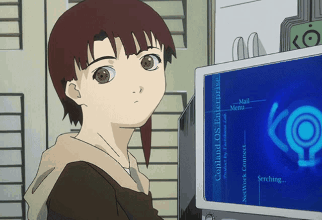

<div align="center">

<br>

<a href="https://github.com/Rahulmohanty637?tab=followers"></a>
<a href="https://github.com/Rahulmohanty637?tab=repositories&sort=stargazers"></a>
</div>


<!--  -->

I'm a full stack developer with a UI/UX background and **2+ years** of experience building production web and mobile apps. I design in **Figma**, build interfaces with **React, Next.js and TypeScript**, and write the APIs behind them with **Python, FastAPI and PostgreSQL** on **AWS**.

I care about the details users notice and the architecture they never have to think about. That means fast, accessible screens on top of reliable APIs and data.

| | |
|---|---|
| `--portfolio` | [rahulm-637.vercel.app](https://rahulm-637.vercel.app/) |
| `--latest` | [Heart2Tail](https://www.heart2tail.in/), a pet-care marketplace I designed and built end to end: web, mobile and backend |
| `--focus` | full stack products, from first sketch to launch |
| `--reach-me-for` | React, Next.js, React Native, FastAPI, PostgreSQL, AWS |
| `--open-to` | full stack roles and freelance work, remote or relocation |


<div align="center">

&nbsp;&nbsp;

&nbsp;&nbsp;

&nbsp;&nbsp;

</div>


```text
2026.01 → 2026.10   Software Engineer             @ Holmes AI      Hyderabad
2024.08 → 2025.12   Assistant System Engineer     @ TCS            Bengaluru
2024.03 → 2024.05   Full Stack Developer Intern   @ Gram Tarang    Bhubaneswar
2022    → 2024      MCA, Gold Medalist            @ Centurion University of Technology and Management
```


<div align="center">


</div>


<div align="center">
<a href="https://rahulm-637.vercel.app/"></a>
<a href="https://linkedin.com/in/rahul-mohanty-4aa7bb203"></a>
<a href="https://www.upwork.com/freelancers/~015de516fa45db6cb4"></a>
<a href="https://leetcode.com/u/monty_rahul_/"></a>
<a href="https://x.com/RahulMo89176947"></a>
<a href="mailto:rahulmohanty637@gmail.com"></a>
</div>


